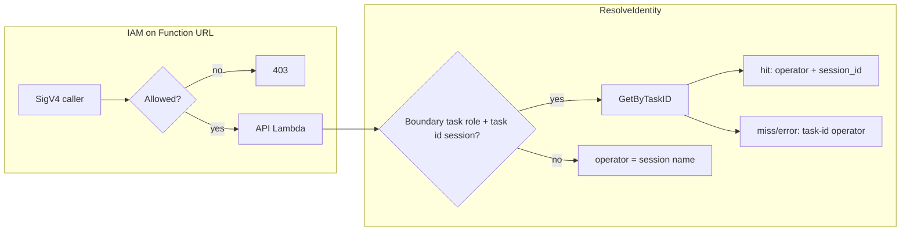
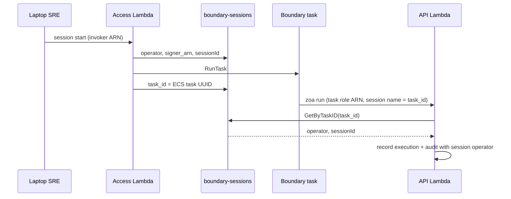

# ZOA Boundary — Identity bridge

The **identity bridge** is how ZOA attributes **Trusted Actions** and **API audit** to the **`operator`** who started the boundary session when the HTTP caller is an **ECS task role** shared by every container on a target. Without it, audit would show only an ECS task UUID, not the session owner (e.g. `slopezma`).

**`operator`** in ZOA is the **entity that started the session** — typically an SRE username from the invoker ARN’s STS session name, but the same field holds any non-spoofable id from that ARN (e.g. CI automation, integration principal). It is not limited to human users.

**Full chain (laptop → TA):** [Operator workflow #4](../guides/operator-workflow.md#4-start-session-join-exec-and-ownership).  
**Operator guide (credentials and workflow):** [Operator workflow — Identity and SigV4](../guides/operator-workflow.md#identity-and-sigv4).  
**Session row storage and GSIs:** [Storage — boundary sessions](../architecture/storage.md#boundary-sessions).

## Invoke access vs audit attribution

| Concern                                      | Enforced where                                                 | Role of this doc                                          |
| -------------------------------------------- | -------------------------------------------------------------- | --------------------------------------------------------- |
| **Who may call the API URL**                 | Function URL **IAM resource policy** (rosa-seaplane Terraform) | Not in Go — SigV4 + authorizer only; no identity headers. |
| **Who appears as `operator` / `session_id`** | API Lambda — `ResolveIdentity` (`authorizer.iam.userArn`)      | Bridge + fallbacks below.                                 |

The **designed API caller** is the boundary **ECS task role** (`{TARGET_CLUSTER}-zoa-boundary-task`). The bridge maps that caller’s STS session name (the **ECS task id**) to **`operator`** and ZOA **`session_id`** in **`boundary-sessions`** (the values written at session start).
Additional principals on the API URL, if any, are a **deploy-time IAM choice** per environment. The Lambda still attributes them using the STS session name on their ARN (no Dynamo bridge). Details: [Identity bridge — algorithm](#solution-task-id--session-row--operator) and `pkg/api/identity.go`.



## Three different “session” identifiers (do not mix them)

| Name                                       | Example                                | Who assigns it                          | Used for                                                                                 |
| ------------------------------------------ | -------------------------------------- | --------------------------------------- | ---------------------------------------------------------------------------------------- |
| **ZOA boundary `session_id`**              | `bcacb5bb-041b-47e7-b839-6ad619f6a91b` | Access at `session_start` (DynamoDB PK) | Audit join key on executions/audit; shell prompt `sessionId:…`; `zoa session terminate`  |
| **ECS task id** (`task_id` on session row) | `699b33207f394816a9ecf16b6789174e`     | ECS at `RunTask`                        | **Identity bridge lookup key**; last segment of boundary **`signer_arn`**                |
| **ECS Exec / SSM session id**              | `irrn2yhacfirattxuxr82p2jla`           | AWS when you `session join`             | CloudWatch stream `ecs-execute-command-<id>`; optional `exec_session_ids` on session row |

The bridge maps **ECS task id → ZOA `session_id` → `operator`**. It does **not** use the SSM Exec session id.

## Problem

| Plane               | Who signs SigV4?         | What IAM sees                             |
| ------------------- | ------------------------ | ----------------------------------------- |
| **Access** (laptop) | Invoker assumed-role ARN | Session name = **`operator`** id at start |
| **API** (boundary)  | ECS **task role** ARN    | Session name = **ECS task id** (UUID)     |

Every boundary task on a target uses the **same IAM role name** on the task definition (`…-zoa-boundary-task`). That is **not** the same as **`signer_arn`**: each running task gets its **own** assumed-role ARN because the STS **session name** is that task’s unique **ECS task id**.

Example (two concurrent sessions, same **`operator`**, same TA):

```text
signer_arn …/eph-3cfd072c-regional-zoa-boundary-task/699b33207f394816a9ecf16b6789174e  → session_id bcacb5bb-…
signer_arn …/eph-3cfd072c-regional-zoa-boundary-task/0bccef919df64023ba6d357483616bbf  → session_id 59b90543-…
```

Both rows show `operator: slopezma` because the API looked up each **task id** in **`boundary-sessions`**.

Shell env vars such as `ZOA_OPERATOR` are set at `RunTask` for prompts and Claude context. **They are not audit truth** — the API Lambda must not trust client-supplied operator headers for attribution.

## Solution: task id → session row → operator

At **session start**, Access Lambda writes a DynamoDB row in **`boundary-sessions`** with:

- **`sessionId`** — ZOA boundary session UUID (primary key; stable audit handle)
- **`operator`** — entity id from invoker ARN session name (set at `session_start`)
- **`signer_arn`** — full **invoker** ARN at start
- **`account_id`**, **`reason`**, **`target_cluster`**, **`deadline`**, etc.

When the Fargate task is running, Access updates the row with **`task_id`** (ECS task UUID) and **`task_arn`**. That **`task_id`** equals the **session name** on the task role’s `sts:GetCallerIdentity().Arn` when the container calls the API.

On every **API Lambda** request:

1. Read **`signer_arn`** from the **Lambda IAM authorizer** (`requestContext.authorizer.iam.userArn`) — the same principal SigV4 authenticated. Client headers are **not** used for identity.
2. Parse **role name** and **session name** from the assumed-role ARN.
3. **Bridge lookup** runs only when role name is **`{TARGET_CLUSTER}-zoa-boundary-task`** (API env `TARGET_CLUSTER`, same as Terraform) **and** session name is the ECS task id (32-char hex).
4. **`GetByTaskID(sessionName)`** on GSI **`task-id-index`**.
5. **Hit** → **`operator`** and **`session_id`** from the row on executions and audit.
6. **Miss or Dynamo error** on that boundary caller → [Bridge unresolved](#bridge-unresolved-miss-or-dynamo-error).
7. **Any other authenticated caller** (IAM policy permitting) → **`operator`** = STS session name; **`session_id`** empty; no bridge.

The bridge **attributes** audit fields; it does **not** grant or deny invoke access.



## Bridge unresolved (miss or Dynamo error)

When the boundary task role calls the API but **`GetByTaskID`** finds no row or DynamoDB fails, the API cannot copy the session **`operator`** string onto the execution/audit row **in that request**. The TA still runs.

**Accountability is not lost.** Each ECS task id is **unique to one running boundary task**. Access assigns that id to **one** row in **`boundary-sessions`** (with **`operator`** set at session start). The API records the same task id as **`operator`** when the bridge misses, plus full **`signer_arn`**. That is enough to tie the action to a single session and a single session owner after lookup—even without the friendly **`operator`** string on the row at write time.

| What failed                                                                     | What you still have                                                                                                                       |
| ------------------------------------------------------------------------------- | ----------------------------------------------------------------------------------------------------------------------------------------- |
| Bridge did not return session **`operator`** / **`session_id`** on this request | **`operator`** = ECS task id; **`signer_arn`** = task-role ARN; task id is **1:1** with a session row once Access persisted **`task_id`** |

Sustained miss/error alerts mean **fix mapping or timing** (misconfiguration, race, DynamoDB), not anonymous TA execution.

| Behavior                             | Detail                                                                                                                                              |
| ------------------------------------ | --------------------------------------------------------------------------------------------------------------------------------------------------- |
| **TA execution**                     | Still allowed — lookup failure does not block the action.                                                                                           |
| **`operator` on audit / executions** | ECS task id (hex from **`signer_arn`**).                                                                                                            |
| **`session_id`**                     | Empty on the execution row until a later bridge hit or manual correlation.                                                                          |
| **Logs**                             | API Lambda warns (`identity bridge unresolved: operator set to ecs task id`). Metrics/alerts for sustained miss/error rates are defined separately. |

**Remediation:** Query **`boundary-sessions`** by **`task_id`** (GSI **`task-id-index`**) → **`operator`**, ZOA **`session_id`**, **`reason`**, etc. Typical causes: API call before Access persisted **`task_id`**, missing/stale row, or DynamoDB outage. After the row is correct, later requests can populate **`session_id`** on bridge hit; past rows keep the task id unless reprocessed elsewhere.

## Uniform identity fields

| Field        | Meaning                                          | Sessions (Access)  | Executions / audit (API)                                                                     |
| ------------ | ------------------------------------------------ | ------------------ | -------------------------------------------------------------------------------------------- |
| `operator`   | Session owner id (e.g. `slopezma`, CI principal) | At `session_start` | Bridge hit; or ECS task id when [bridge unresolved](#bridge-unresolved-miss-or-dynamo-error) |
| `signer_arn` | SigV4 caller ARN for this event                  | Invoker at start   | **Per-task** task-role ARN on boundary `zoa run`                                             |
| `session_id` | **ZOA boundary** session UUID                    | Table PK           | Set when bridge hits; **empty/omitted** for direct API callers (no boundary session)       |
| `account_id` | Caller AWS account                               | At start           | On API requests                                                                              |

**Not identity:** `reason` (change ticket on session / TA), `task_id` / `task_arn` (ECS resources on the **session row** only), **`exec_session_ids`** (SSM Exec ids for CloudWatch only).

## Implementation references

| Component             | Location                                           |
| --------------------- | -------------------------------------------------- |
| Bridge algorithm      | `pkg/api/identity.go` — `ResolveIdentity`          |
| IAM caller on request | `pkg/lambdahttp` — authorizer `userArn` in context |
| Access session writes | `pkg/api/access.go`                                |
| Session store + GSI   | `pkg/store/session.go` — `GetByTaskID`             |
| Audit on API          | `pkg/api/router.go`, `pkg/api/dispatch.go`         |

## Security properties

- The session owner **cannot** change the ECS task id or repoint the session mapping from inside the shell.
- **Session join** requires **ownership**: Access compares invoker identity to stored **`operator`** before vending Exec credentials.
- **Exec credentials** are scoped to **one task ARN**; guessing another task id does not grant Exec.
- The task role **cannot** invoke Access or mutate session rows; it is limited to the **API** plane (Trusted Actions and related API routes).
